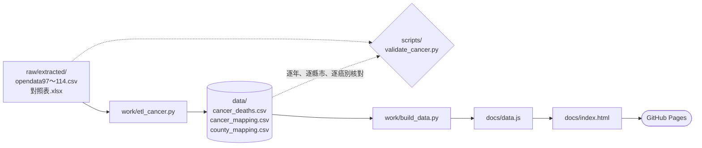

# 台灣癌症死亡人數與趨勢 2008–2025

用衛生福利部統計處的死因統計，整理 2008 至 2025 年台灣惡性腫瘤（癌症）的死亡人數，做成可以互動篩選的 BI 網頁。

**網站：<https://crazray1520.github.io/cancer-statistics/>**

- 只有死亡人數，沒有死亡率。各縣市人口數和年齡結構不同，不能直接用人數比較縣市的癌症風險。
- 這是死亡資料，不是癌症發生（新診斷）資料。

## 資料來源

| 項目 | 內容 |
|---|---|
| 資料名稱 | 死因統計(138分類)，按縣市及五齡分 |
| 提供機關 | 衛生福利部統計處 |
| 資料集頁面 | <https://data.gov.tw/dataset/46077> |
| 下載網址 | <https://www.mohw.gov.tw/dl-83420-8ac74f07-080f-4b94-8453-ce2a8ee99f8b.html> |
| 資料期間 | 民國 97–114 年，即西元 2008–2025 年 |
| 下載日期 | 2026-10-12 |
| 授權 | 政府資料開放授權條款－第 1 版 |

原檔 SHA-256 和更詳細的紀錄在 [`raw/SOURCES.md`](raw/SOURCES.md)。

## 資料夾結構

```
raw/                      原始資料（未修改）
  死因統計138分類_縣市五齡分_1150831.zip    下載的原檔
  extracted/              ZIP 解壓內容：opendata97～114.csv、對照表.xlsx 等
  SOURCES.md              來源網址、下載日期、SHA-256
work/
  etl_cancer.py           ETL：raw → data/
  build_data.py           data/ → docs/data.js，並核對
data/                     整理後的資料
  cancer_deaths.csv       主要資料
  cancer_mapping.csv      癌別對照（原始名稱、ICD-10、縮短名稱）
  county_mapping.csv      縣市代碼對照
scripts/
  validate_cancer.py      驗證 data/ 與原始檔一致
docs/                     網頁（GitHub Pages 從這裡發佈）
  index.html              BI 網頁
  data.js                 網頁用的資料與 metadata
prompts/                  課程 prompt（P0–P3 與作業說明）
```

## 流程



ETL 做的事：

1. 只讀 `opendata*.csv`，只保留死因代碼 007～043（惡性腫瘤），排除 044（其餘腫瘤）。
2. 癌別：肝細胞癌、肝內膽管癌、其他肝及肝內膽管惡性腫瘤（014、015、016）合併為「肝癌」。排除「其他惡性腫瘤」（043）後，依 2025 年死亡人數取前 10 大，名稱縮短成常用名稱；其餘歸為「其他癌症」。對照寫在 `data/cancer_mapping.csv`。
3. 縣市統一成 2011 年後的 22 縣市：舊臺中縣＋臺中市、臺南縣＋臺南市、高雄縣＋高雄市各自合併，臺北縣稱新北市，桃園縣稱桃園市，名稱一律用「臺」。對照寫在 `data/county_mapping.csv`。縣市代碼對照是從對照表的鄉鎮代碼前兩碼推得，不是官方縣市對照表。
4. 年齡合併成 0-14、15-44、45-64、65-74、75-84、85+ 六組。
5. 性別依對照表轉成「男」「女」，年度由民國年加 1911 轉成西元。

輸出 `data/cancer_deaths.csv`，欄位是 `year, county, cancer, sex, age_group, deaths`，每列是 年度 × 縣市 × 癌別 × 性別 × 年齡組 的死亡人數。原始檔只記錄有死亡的組合，所以沒有人數為 0 的列。

## 怎麼重跑與驗證

需要 [uv](https://docs.astral.sh/uv/)（會自動安裝 pandas、openpyxl）。在專案根目錄執行：

```
uv run work/etl_cancer.py          # 產生 data/*.csv
uv run scripts/validate_cancer.py  # 驗證
uv run work/build_data.py          # 產生 docs/data.js 並核對
```

`validate_cancer.py` 不使用 ETL 的邏輯，直接重讀原始檔，檢查：

- 每一年輸出的死亡人數總和，等於原始檔死因 007～043 的總和。
- 每個縣市每年合併前後的人數一致。
- 每年每個癌別的人數與原始檔一致。
- 沒有空值、沒有負數、2008–2025 年份齊全、縣市剛好 22 個。
- 會印出每年癌症死亡總數，可以和衛福部公布的數字核對。

`build_data.py` 會把 `docs/data.js` 還原成表格，和 `cancer_deaths.csv` 逐格比對，並確認 2008 年為 38,913 人、2025 年為 54,838 人。

在瀏覽器雙擊 `docs/index.html` 就能打開網頁。圖表使用 ECharts（從 cdnjs 載入），所以需要網路。

## 限制說明

- 只計算死亡人數，沒有計算死亡率。各縣市人口結構不同，也沒有考慮人口老化，不能直接比較縣市風險。年齡結構圖中 85 歲以上占比上升，反映的是人口老化，不代表各年齡的癌症風險改變。
- 這是死亡統計，不是癌症發生資料。要看發生率，需要衛福部國民健康署的癌症登記資料，本專案沒有使用。
- 2008–2010 年的原始資料沿用縣市改制前的行政區，已合併為現行縣市；這個對應由代碼推得，可能有誤。
- 癌別是依死因 138 分類整理。「其他癌症」是未單獨列出的多種癌別合計，不參與排名。
- 男女比較中，攝護腺癌（男性特有）和乳癌（幾乎都是女性）標為「性別特有」，不判斷男性是否偏高。
- 癌症指惡性腫瘤，不含「其餘腫瘤」（D00–D48）。
